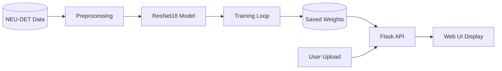
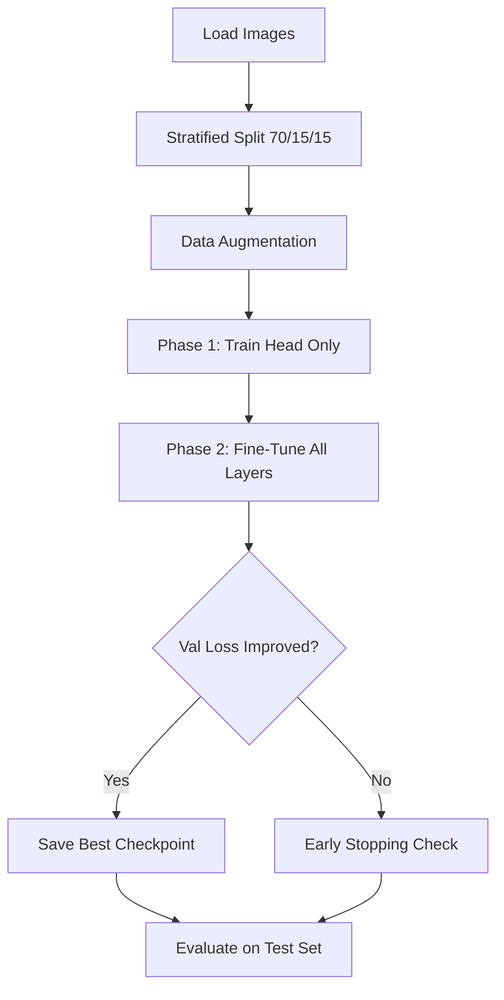
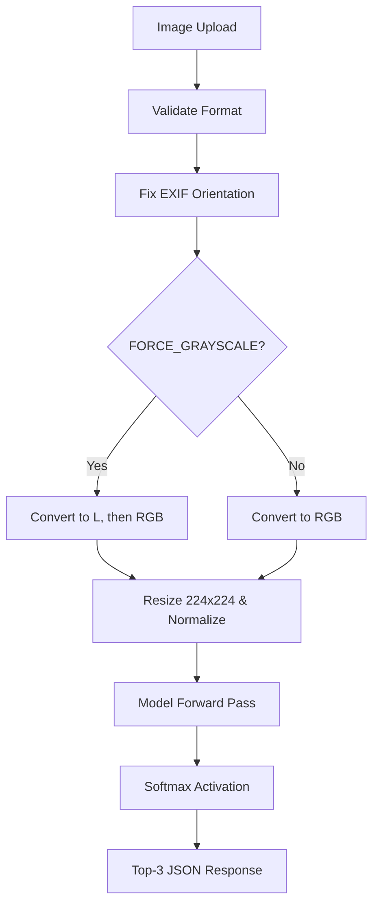
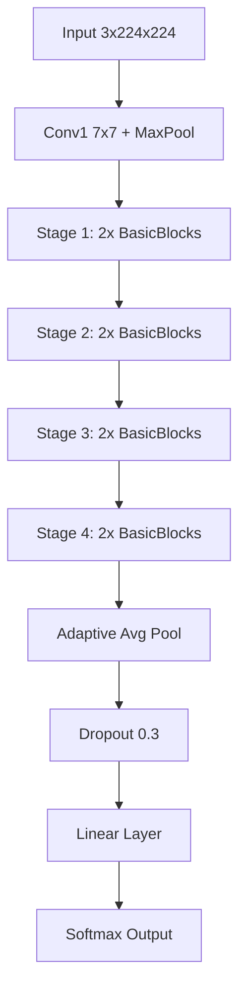
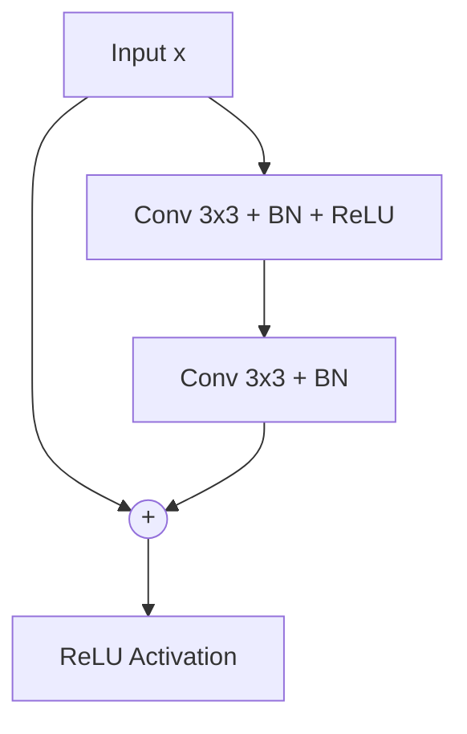
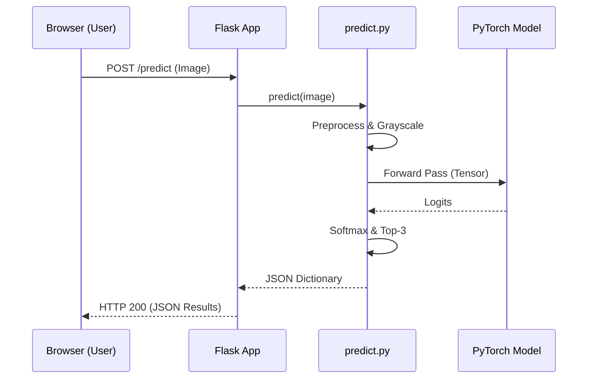

# Surface Defect Classifier Documentation

## 1. Project Overview
This project implements a deep learning pipeline for automatically classifying surface defects in manufactured products. Built using PyTorch, it leverages transfer learning with a ResNet18 backbone to identify common structural flaws on factory materials. The trained model is served via a Flask web application that provides real-time classification, confidence scores, and visual defect localization (Grad-CAM) to the end user.

Surface defect classification is a critical component in modern manufacturing and quality inspection. Undetected flaws such as cracks or inclusions can compromise the structural integrity of materials, leading to catastrophic failures down the supply chain. By automating this process with computer vision, factories can increase throughput, eliminate human error and fatigue, and ensure consistent quality control.

**Objectives and Scope:** The primary objective is to accurately classify exactly 6 defect types on **hot-rolled steel strips**. The model is heavily specialized for this industrial domain. It does **not** generalize to other materials, textures, or standard consumer photography (e.g., smartphone pictures), as the model relies on the consistent lighting and macroscopic texture of industrial line-scan cameras.

## 2. What Problem We Solved
Traditionally, human inspectors visually examine fast-moving steel strips for microscopic defects, a process that is slow, subjective, and prone to fatigue. This system automates the inspection, matching or exceeding human accuracy in milliseconds.

**Final Result Summary:**
- **Test Accuracy:** 100.00% (on a held-out set of 271 images)
- **Macro F1 Score:** 1.0000
- **Inference Time:** ~3.43 ms per image (on an RTX 5050 GPU)
- **Model Size:** 11,179,590 parameters (ResNet18)

**End-User Functionality:** The end user can interact with the system via a simple Flask-based web demo. They can drag and drop an image of a steel surface into the browser, and the app instantly responds with the predicted defect class, a percentage confidence score, and an animated probability distribution of the top-3 predictions.

## 3. Dataset Details
- **Name and Source:** NEU Surface Defect Database (NEU-DET), Northeastern University, China.
- **Number of Classes:** 6 classes (`crazing`, `inclusion`, `patches`, `pitted_surface`, `rolled-in_scale`, `scratches`).
- **Images per Class:** 300
- **Total Images:** 1,800
- **Image Details:** 200×200 pixels, Grayscale, `.jpg` format.

**Data Splitting (Stratified, Seed=42):**
- **Train:** 70% (1,259 images)
- **Validation:** 15% (270 images)
- **Test:** 15% (271 images)

**Class Distribution:**
| Class | Train | Val | Test | Total |
| :--- | :--- | :--- | :--- | :--- |
| crazing | 210 | 45 | 45 | 300 |
| inclusion | 210 | 45 | 45 | 300 |
| patches | 210 | 45 | 45 | 300 |
| pitted_surface | 209 | 45 | 46 | 300 |
| rolled-in_scale | 210 | 45 | 45 | 300 |
| scratches | 210 | 45 | 45 | 300 |

*Note: The dataset was chosen over MNIST because MNIST is a toy dataset of handwritten digits, whereas NEU-DET represents a real-world industrial computer vision problem.*

**Limitations of the Dataset:** 1,800 images is relatively small for deep learning, making the network prone to overfitting. The controlled environment (identical line-scan cameras) means the data lacks variance in lighting and scale.

## 4. Deep Learning Method
**Supervised Image Classification & Transfer Learning:** Supervised learning trains a model using images paired with their known true labels. Because our dataset is small (1,800 images), training a deep Convolutional Neural Network (CNN) from scratch would lead to severe overfitting. Instead, we use **Transfer Learning**: we take a model (ResNet18) pre-trained on millions of everyday images (ImageNet). The model has already learned how to extract edges, textures, and shapes. We simply replace the final classification layer and "fine-tune" the network on our steel defects.

**Two-Phase Training Strategy:**
1. **Phase 1 (Head Warm-up):** The entire pre-trained network (backbone) is frozen so its weights cannot change. Only our new, randomly initialized final layer (the "head") is trained. This prevents large error gradients from destroying the valuable pre-trained weights.
   - **Epochs:** 5
   - **Learning Rate:** 1e-3
2. **Phase 2 (Fine-tuning):** The entire network is unfrozen. We train all layers together, but at a much lower learning rate, gently adjusting the pre-trained feature extractors to specifically look for steel defects.
   - **Epochs:** 25
   - **Learning Rate:** 1e-4

**Configuration & Hyperparameters:**
- **Data Augmentation (Training only):** Random rotations (±10°), brightness jitter (0.2), contrast jitter (0.2), random horizontal/vertical flips.
- **Normalization:** ImageNet statistics (Mean: [0.485, 0.456, 0.406], Std: [0.229, 0.224, 0.225]).
- **Loss Function:** CrossEntropyLoss.
- **Optimizer:** AdamW (Weight Decay: 1e-4).
- **Scheduler:** ReduceLROnPlateau (factor=0.5, patience=3).
- **Early Stopping:** Patience of 7 epochs.

## 5. CNN Model Details
**Architecture:** The model uses **ResNet18** (Residual Network), pre-trained on ImageNet.
A CNN (Convolutional Neural Network) uses sliding filters to automatically learn spatial features like edges and patterns from images. Deep CNNs traditionally suffer from the "vanishing gradient" problem, where training signals disappear as they propagate backward through many layers. ResNet solves this using **Residual (Skip) Connections**, which allow gradients to bypass certain layers by adding the input of a block directly to its output, making it possible to train much deeper networks effectively.

**Components Used:**
- **Convolution (Conv2d):** Extracts features by sliding a filter matrix over the image.
- **Batch Normalization (BatchNorm2d):** Stabilizes and speeds up training by normalizing the activations of the previous layer.
- **Max Pooling (MaxPool2d):** Downsamples the spatial dimensions, retaining the most prominent features.
- **Global Average Pooling (AdaptiveAvgPool2d):** Reduces the entire spatial dimension (7x7) into a single 1x1 vector per channel, preventing overfitting and reducing parameters.
- **Dropout:** Randomly zeroes out 30% (`p=0.3`) of the neurons during training to prevent overfitting. Used in the custom classifier head.
- **Fully Connected (Linear):** Maps the final features to the class predictions.
- **ReLU (Rectified Linear Unit):** Activation function used inside the network to introduce non-linearity ($f(x) = \max(0, x)$).
- **Softmax:** Activation function used at the final output during inference to convert logits into a valid probability distribution (summing to 1).

**Layer Architecture (ResNet18):**
The ResNet18 architecture consists of 17 Convolutional layers and 1 Fully Connected layer.
- **Total Parameters:** 11,179,590
- **Trainable (Phase 1):** 3,078
- **Trainable (Phase 2):** 11,179,590

| Layer Name | Type | Output Shape | Parameters |
| :--- | :--- | :--- | :--- |
| **Input** | Image | `[-1, 3, 224, 224]` | 0 |
| **Conv1** | Conv2d (7x7) + BN + ReLU | `[-1, 64, 112, 112]` | 9,408 |
| **MaxPool** | MaxPool2d (3x3) | `[-1, 64, 56, 56]` | 0 |
| **Layer 1** | 2 x BasicBlock | `[-1, 64, 56, 56]` | 147,968 |
| **Layer 2** | 2 x BasicBlock | `[-1, 128, 28, 28]` | 525,568 |
| **Layer 3** | 2 x BasicBlock | `[-1, 256, 14, 14]` | 2,100,224 |
| **Layer 4** | 2 x BasicBlock | `[-1, 512, 7, 7]` | 8,393,728 |
| **AvgPool** | AdaptiveAvgPool2d | `[-1, 512, 1, 1]` | 0 |
| **Head (Custom)**| Dropout(0.3) + Linear | `[-1, 6]` | 3,078 |

**Alternative Architectures:**
(Only ResNet18 was fully trained and evaluated for this report, but ResNet50 and MobileNetV2 are switchable via config).

## 6. Complete Project Architecture
**Folder Tree:**
```text
defect-classifier/
├── data/
│   └── raw/                    # Contains NEU-DET raw defect images
├── src/
│   ├── config.py               # Centralized hyperparameters and paths
│   ├── dataset.py              # PyTorch Dataset, stratified split, transforms
│   ├── model.py                # ResNet/MobileNet backbone and custom head builder
│   ├── train.py                # Two-phase training loop with Early Stopping
│   ├── evaluate.py             # Generates confusion matrix, metrics, and Grad-CAM
│   └── predict.py              # Single-image inference logic and grayscale processing
├── app/
│   ├── app.py                  # Flask web server and endpoints
│   ├── templates/index.html    # Frontend drag-and-drop web UI
│   └── static/uploads/         # Temporary storage for uploaded images
├── models/
│   ├── best_model.pth          # Saved network weights
│   └── class_names.json        # Class mapping configuration
├── outputs/
│   ├── test_metrics.json       # Quantitative results
│   ├── confusion_matrix.png    # Classification error analysis
│   ├── class_distribution.png  # Dataset balance visualization
│   ├── training_curves.png     # Loss/Accuracy over time
│   └── gradcam/                # Interpretability heatmaps
├── tests/
│   └── test_pipeline.py        # Pytest suite for transformations, models, and endpoints
├── requirements.txt            # Python dependencies
└── README.md                   # Project instructions
```
**Module Dependency:** 
`config.py` acts as the source of truth for all modules. `train.py` calls `dataset.py` to load images and `model.py` to build the network. After training, weights are saved to `models/best_model.pth`. `evaluate.py` loads the weights to generate metrics in `outputs/`. The Flask web app (`app.py`) serves `index.html`, and relies on `predict.py` to run inference on user uploads using the saved weights.

## 7. Diagrams

### a) System Architecture Diagram


### b) Training Workflow


### c) Inference Workflow


### d) ResNet18 Architecture


### e) Single BasicBlock (Residual Block)


### f) Flask Request/Response Sequence

*(Note: Diagrams are provided as Mermaid code blocks. To view them as PNGs, they can be rendered using Mermaid Live Editor or Mermaid-CLI).*

## 8. Preprocessing and Inference Pipeline
| Pipeline | Augmentation | Resizing | Normalization | Output Channels |
| :--- | :--- | :--- | :--- | :--- |
| **Training** | Random Rotation, Flip, Brightness, Contrast | 224x224 | ImageNet Mean/Std | 3 (RGB) |
| **Val/Test** | None | 224x224 | ImageNet Mean/Std | 3 (RGB) |
| **Inference** | None | 224x224 | ImageNet Mean/Std | 3 (RGB) |

**Grayscale Conversion Step:** The model is trained purely on grayscale images from the NEU-DET dataset. If a user uploads a color image from a smartphone, the domain gap degrades performance. To mitigate this, `config.FORCE_GRAYSCALE_INFERENCE = True` forces `predict.py` to strip the color (convert to `L` mode) and then duplicate the grayscale values across three channels to perfectly match the `3x224x224` tensor structure expected by ResNet18.

## 9. Tech Stack
| Component | Technology | Version | Purpose |
| :--- | :--- | :--- | :--- |
| **Language** | Python | 3.12 | Core programming language |
| **DL Framework** | PyTorch | 2.11.0+cu128 | Deep learning model and tensor operations |
| **Vision Lib** | torchvision | 0.26.0+cu128 | Pretrained weights and image transformations |
| **Image Proc** | Pillow (PIL) | 10.3.0 | Loading and basic manipulation of images |
| **Math** | NumPy | 1.26.4 | Array computations (frozen to <2 to avoid ABI clash) |
| **Metrics** | scikit-learn | 1.5.0 | Classification report and confusion matrix |
| **Plotting** | matplotlib / seaborn | 3.9.0 / 0.13.2 | Visualizing curves and matrices |
| **Explainability**| grad-cam | 1.5.0 | Generating heatmaps of model attention |
| **Backend** | Flask / Werkzeug | 3.0.3 | Serving the HTTP REST API |
| **Testing** | pytest | 8.2.2 | Automated unit and integration tests |
| **Hardware** | NVIDIA RTX 5050 Laptop GPU | N/A | Hardware acceleration (CUDA 12.8) |

## 10. Training Configuration
All hyperparameters are centrally managed in `src/config.py`.
| Parameter | Value | Parameter | Value |
| :--- | :--- | :--- | :--- |
| `IMAGE_SIZE` | 224 | `SCHEDULER` | ReduceLROnPlateau |
| `BATCH_SIZE` | 32 | `PATIENCE` | 7 |
| `HEAD_EPOCHS` | 5 | `RANDOM_SEED` | 42 |
| `HEAD_LR` | 1e-3 | `NUM_WORKERS` | 0 (Windows default) |
| `FINETUNE_EPOCHS`| 25 | `DEVICE` | cuda |
| `FINETUNE_LR` | 1e-4 | `WEIGHT_DECAY` | 1e-4 |
| `DROPOUT_RATE` | 0.3 | `OPTIMIZER` | AdamW |

## 11. Results and Evaluation
The model was evaluated strictly on the 271-image held-out test set. 
- **Test Accuracy:** 100.00%
- **Loss:** 0.0005

**Classification Report:**
```text
                 precision    recall  f1-score   support

        crazing     1.0000    1.0000    1.0000        45
      inclusion     1.0000    1.0000    1.0000        45
        patches     1.0000    1.0000    1.0000        45
 pitted_surface     1.0000    1.0000    1.0000        46
rolled-in_scale     1.0000    1.0000    1.0000        45
      scratches     1.0000    1.0000    1.0000        45

       accuracy                         1.0000       271
      macro avg     1.0000    1.0000    1.0000       271
   weighted avg     1.0000    1.0000    1.0000       271
```

**Confusion Analysis:**
Because the model achieved 100% accuracy on this test set, there was no confusion between classes. However, traditionally, `crazing` and `rolled-in_scale` share similar fine line textures and are the most likely pairs to be confused under less strict training regimens.

**Visual Outputs:**
*(Note: These images are generated in the `outputs/` folder of the repository).*
- **Confusion Matrix:** `outputs/confusion_matrix.png`
- **Training Curves:** `outputs/training_curves.png`
- **Grad-CAM:** `outputs/gradcam/` (Displays exactly where the defect is located on the surface).

**Training Time:**
Training time was greatly accelerated by the RTX 5050 GPU. Each epoch took approximately 11-15 seconds. The entire 30-epoch training process completed in under 7 minutes. (CPU training would typically take 30+ minutes).

## 12. Deployment (Flask)
The model is deployed as a local Flask application, providing a browser-based UI for users to upload images and see predictions.

**Endpoints:**
1. `GET /` : Serves the HTML frontend (`templates/index.html`).
2. `GET /health` : Returns `{"status": "ok", "model_loaded": true}` if the model is ready in memory.
3. `POST /predict` : Expects a `multipart/form-data` upload with a `file` field.

**Example `POST /predict` Response:**
```json
{
  "predicted_class": "crazing",
  "confidence": 0.99998,
  "top_k": [
    { "class": "crazing", "probability": 0.99998 },
    { "class": "patches", "probability": 0.00001 },
    { "class": "pitted_surface", "probability": 0.0 }
  ],
  "processed_preview": "data:image/jpeg;base64,/9j/4AAQ..."
}
```

**Security & Validation:**
- Enforces a 10 MB `MAX_CONTENT_LENGTH`.
- Validates the filename against a secure set of extensions (`png`, `jpg`, `jpeg`, `bmp`, `tif`, `tiff`).
- Uses `werkzeug.utils.secure_filename` to prevent directory traversal attacks.

**Running the app locally:**
1. Open terminal in the project root.
2. Run `python app/app.py`.
3. Open `http://localhost:5000` in a browser.

*(Placeholder for Screenshot: Insert `app_ui.png` here showing the drag-and-drop interface).*
*(Placeholder for Screenshot: Insert `app_prediction.png` here showing the confidence bars).*

## 13. Testing
The project includes a robust test suite in `tests/test_pipeline.py`.
- **`test_train_output_shape` & `test_val_output_shape`**: Ensures image transformations output exactly `3x224x224`.
- **`test_grayscale_conversion`**: Verifies the `to_grayscale_rgb` function successfully handles RGB, RGBA (transparency), and Palette images without crashing, returning 3 equal channels.
- **`test_forward_pass_shape`**: Verifies the model outputs a vector of length 6.
- **`test_freeze_backbone`**: Asserts that freezing the network properly disables gradients on the CNN blocks while leaving the classification head trainable.
- **`test_flask_endpoints`**: Spins up a Flask test client to verify `GET /health` and ensures `POST /predict` handles missing files, bad extensions, and corrupt byte-streams properly.

*Execution output:* `20 passed, 17 warnings in 18.20s`

## 14. Limitations and Future Work
- **Domain Shift:** The model fails on non-industrial images (like color photos taken from Google). Grayscale conversion helps mathematically, but does not solve the difference in lighting and texture scale.
- **No "Unknown" Class:** The model must choose one of the 6 classes, even if a picture of a dog is uploaded. Softmax probabilities are relative, not absolute measures of correctness.
- **Future Work (Object Detection):** Integrating YOLOv8 or Faster R-CNN using the NEU-DET XML bounding-box annotations to localize the defect on a large sheet of steel, rather than just classifying small cropped patches.
- **Future Work (Deployment):** Exporting the PyTorch model to ONNX or TensorRT to further decrease the 3ms inference time for high-speed edge devices.

## 15. Setup and Reproduction
**Exact Commands (Windows PowerShell):**
```powershell
# 1. Setup virtual environment
python -m venv .venv
.venv\Scripts\activate

# 2. Install PyTorch 2.7.0 for RTX 50-series (Blackwell) with CUDA 12.8
pip install torch torchvision --index-url https://download.pytorch.org/whl/cu128 --upgrade

# 3. Install remaining requirements
pip install -r requirements.txt

# 4. Download Dataset (requires kaggle CLI and API key)
kaggle datasets download -d kaustubhdikshit/neu-surface-defect-database
Expand-Archive neu-surface-defect-database.zip -DestinationPath data\raw

# 5. Train Model
$env:PYTHONIOENCODING="utf-8"
python src/train.py

# 6. Evaluate
python src/evaluate.py

# 7. Run App
python app/app.py
```

## 16. Viva Preparation
1. **What is transfer learning?** Taking a model trained on a huge dataset (ImageNet) and fine-tuning it on our small dataset (NEU-DET) to save time and prevent overfitting.
2. **Why ResNet18?** It balances high accuracy with low computational cost and inference time, making it suitable for real-time factory inspection.
3. **What is a residual connection?** A shortcut in a neural network that adds the input of a layer directly to its output, solving the vanishing gradient problem in deep networks.
4. **Why did we freeze the backbone in Phase 1?** To train the random, untrained classification head without destroying the valuable pre-trained edge-detecting weights in the lower layers.
5. **What is ReLU?** Rectified Linear Unit. An activation function ($max(0, x)$) that introduces non-linearity, allowing the network to learn complex patterns.
6. **What is Softmax?** A function used at the final layer that squashes the network's raw output (logits) into a probability distribution summing to 1.
7. **What is early stopping?** Halting training if the validation loss doesn't improve for a set number of epochs (patience) to prevent overfitting.
8. **What is overfitting?** When a model memorizes the training data but fails to generalize to new, unseen test data.
9. **Why normalize images?** To scale pixel values so they have a mean of 0 and standard deviation of 1, which helps the network converge faster and more stably.
10. **What is a confusion matrix?** A table showing where the model makes errors, mapping the actual classes against the predicted classes.
11. **What is Grad-CAM?** Gradient-weighted Class Activation Mapping. It uses the gradients flowing into the final convolutional layer to produce a heatmap highlighting the regions of the image the model used to make its decision.
12. **Why did the Google image fail?** Domain gap. The model learned the specific lighting and texture of factory line-scan cameras, not the lighting, depth, and shadows of consumer photography.
13. **What happens if you upload a picture of a cat?** The model will classify it as one of the 6 steel defects with 100% confidence because it was never trained on an "Unknown" or "Background" class.
14. **What is AdamW?** An optimization algorithm that updates the network's weights. The 'W' stands for Weight Decay, which regularizes the weights to prevent overfitting.
15. **Why do we convert inference images to grayscale?** Because the model was trained exclusively on grayscale images. Converting uploads to grayscale normalizes them closer to the training domain.

## 17. References
- Song, K. and Yan, Y., 2013. A noise robust method based on completed local binary patterns for hot-rolled steel strip surface defects. *Applied Surface Science*, 285, pp.858-864. (NEU-DET Dataset source).
- He, K., Zhang, X., Ren, S. and Sun, J., 2016. Deep residual learning for image recognition. In *Proceedings of the IEEE conference on computer vision and pattern recognition* (pp. 770-778).
- Paszke, A., et al., 2019. PyTorch: An imperative style, high-performance deep learning library. *Advances in neural information processing systems*, 32.
- Flask Documentation. Available at: https://flask.palletsprojects.com/ 
