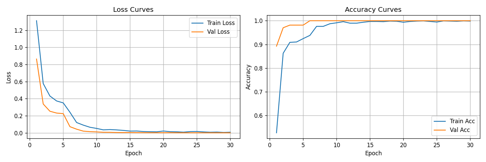
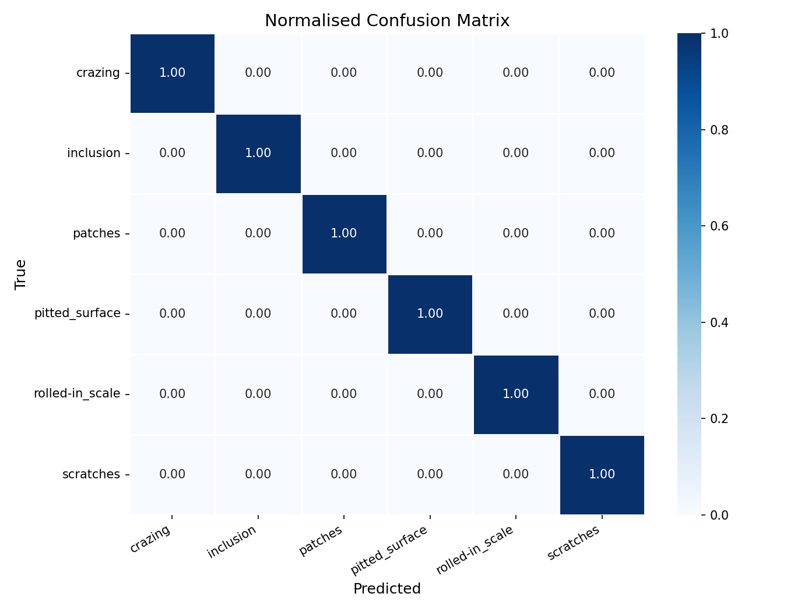
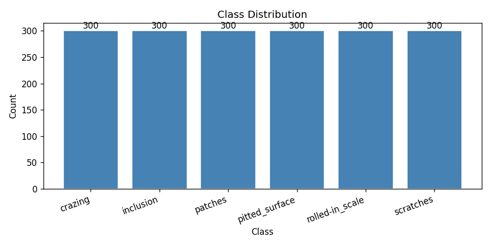
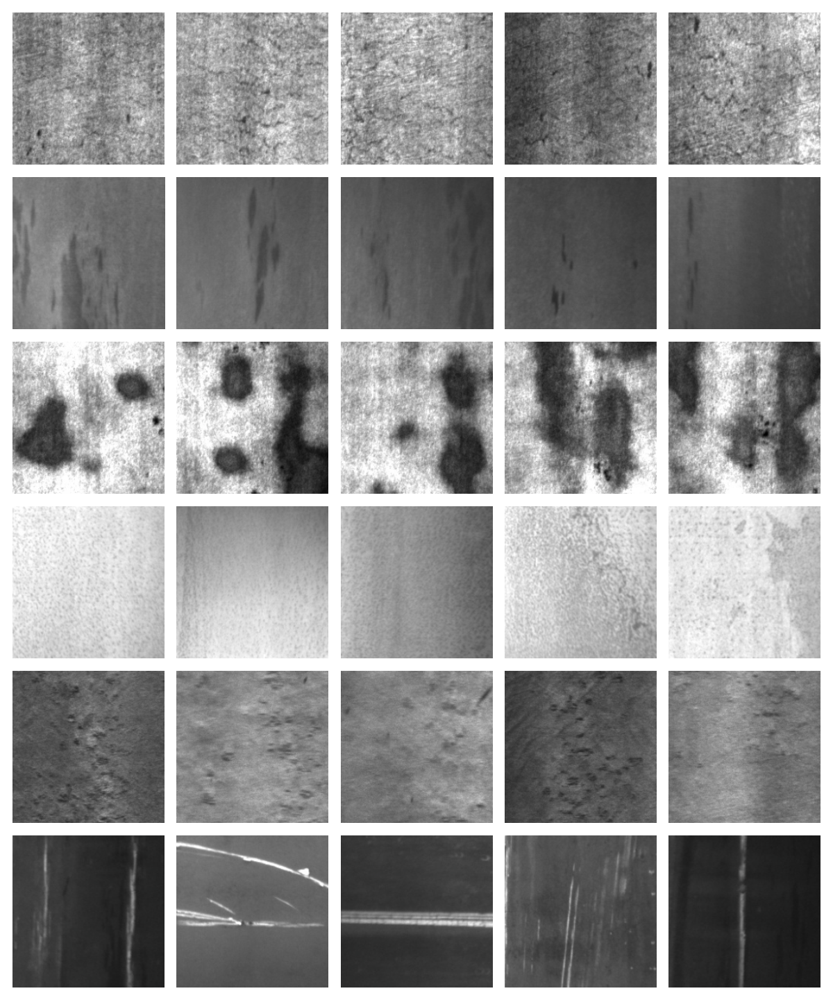
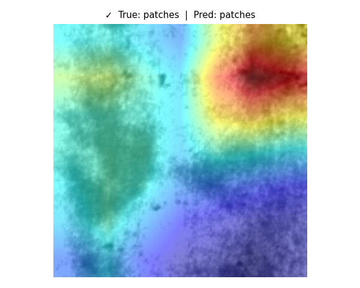
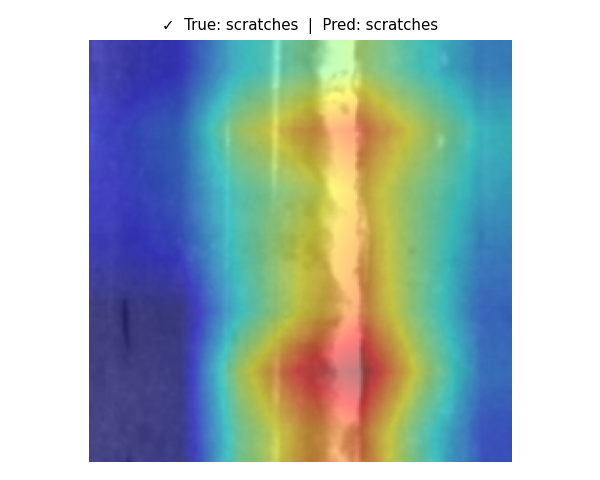
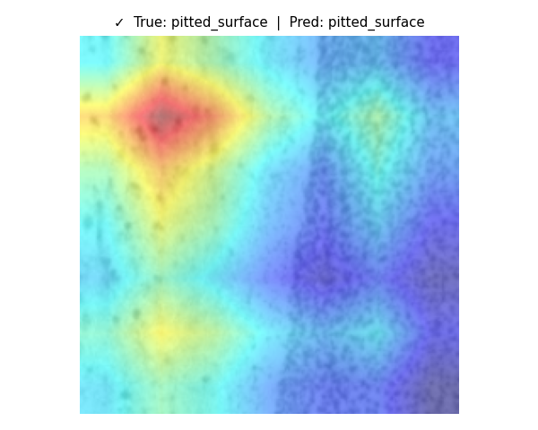

<h1 align="center">🔍 Surface Defect Classifier</h1>

<p align="center">
  <b>Deep learning pipeline for classifying surface defects in hot-rolled steel strips</b><br>
  Transfer Learning · ResNet18 · Flask Web Demo · Grad-CAM
</p>

<p align="center">
  
  
  
  
  
</p>

---

## Table of Contents
1. [Project Overview](#1-project-overview)
2. [Results](#2-results)
3. [Dataset Setup](#3-dataset-setup)
4. [Quick Start](#4-quick-start)
5. [How to Train](#5-how-to-train)
6. [How to Evaluate](#6-how-to-evaluate)
7. [How to Run the App](#7-how-to-run-the-app)
8. [Project Structure](#8-project-structure)
9. [Inference Preprocessing](#9-inference-preprocessing)
10. [Known Limitations](#10-known-limitations)

---

## 1. Project Overview

| Item | Detail |
|------|--------|
| **Task** | 6-class image classification of steel surface defects |
| **Classes** | `crazing`, `inclusion`, `patches`, `pitted_surface`, `rolled-in_scale`, `scratches` |
| **Dataset** | NEU Surface Defect Database — 1,800 grayscale images, 300/class |
| **Backbone** | ResNet18 pretrained on ImageNet (switchable to ResNet50 / MobileNetV2) |
| **Strategy** | Two-phase fine-tuning: head warm-up (5 epochs) → full unfreeze (25 epochs) |
| **Frontend** | Flask + vanilla JS, drag-and-drop upload, animated confidence bars |
| **Hardware** | NVIDIA RTX 5050 Laptop GPU (Blackwell, CUDA 12.8) |

---

## 2. Results

### Test Performance (ResNet18, held-out 271 images)

| Metric | Value |
|--------|-------|
| **Test Accuracy** | **100.00%** |
| **Macro F1 Score** | **1.0000** |
| **Inference Time** | **~3.43 ms / image** (GPU) |
| **Total Parameters** | 11,179,590 |
| **Trainable — Phase 1** | 3,078 |
| **Trainable — Phase 2** | 11,179,590 |

### Per-Class Classification Report

```
                 precision    recall  f1-score   support

        crazing     1.0000    1.0000    1.0000        45
      inclusion     1.0000    1.0000    1.0000        45
        patches     1.0000    1.0000    1.0000        45
 pitted_surface     1.0000    1.0000    1.0000        46
rolled-in_scale     1.0000    1.0000    1.0000        45
      scratches     1.0000    1.0000    1.0000        45

       accuracy                         1.0000       271
      macro avg     1.0000    1.0000    1.0000       271
   weighted avg     1.0000    1.0000    1.0000       271
```

### Training Curves



### Confusion Matrix



### Class Distribution



### Sample Image Grid (one per class)



### Grad-CAM Visualizations
> The model highlights the exact defect region on each image (bright = high attention).

| Correct — Patches | Correct — Scratches | Correct — Pitted Surface |
|:-:|:-:|:-:|
|  |  |  |

---

## 3. Dataset Setup

### Option A — Kaggle (recommended)

```bash
pip install kaggle
kaggle datasets download -d kaustubhdikshit/neu-surface-defect-database
Expand-Archive neu-surface-defect-database.zip -DestinationPath data/raw
```

> Requires a `~/.kaggle/kaggle.json` API key. Get it at https://www.kaggle.com/settings/account

**Expected folder layout (either format is auto-detected):**

```
data/raw/
├── crazing/          ← 300 images   (class-subfolder layout)
├── inclusion/
├── patches/
├── pitted_surface/
├── rolled-in_scale/
└── scratches/
```
— OR flat —
```
data/raw/
├── crazing_1.jpg
├── crazing_2.jpg
└── ...scratches_300.jpg
```

### Option B — Official source
Download from: http://faculty.neu.edu.cn/yunhyan/NEU_surface_defect_database.html

---

## 4. Quick Start

```bash
# 1. Clone the repo
git clone https://github.com/sabarisastha/Surface-Defect-Classifier.git
cd Surface-Defect-Classifier

# 2. Create and activate virtual environment
python -m venv .venv
.venv\Scripts\activate          # Windows
# source .venv/bin/activate     # Linux / macOS

# 3. Install dependencies
pip install -r requirements.txt

# 4. RTX 50-series GPU (Blackwell)? Install PyTorch with CUDA 12.8:
pip install torch torchvision --index-url https://download.pytorch.org/whl/cu128 --upgrade

# 5. Verify setup (no dataset needed)
pytest tests/ -v
```

---

## 5. How to Train

```bash
# Default: ResNet18, 5 warm-up epochs + 25 fine-tune epochs
python src/train.py

# Switch backbone
python src/train.py --arch resnet50
python src/train.py --arch mobilenet_v2

# Custom epochs / learning rate
python src/train.py --arch resnet18 --epochs-head 8 --epochs-ft 40 --lr-ft 5e-5
```

Training artefacts are written to:
- `models/best_model.pth` — best checkpoint by validation loss
- `models/class_names.json` — ordered class list
- `outputs/training_curves.png`
- `outputs/sample_grid.png`
- `outputs/class_distribution.png`

---

## 6. How to Evaluate

```bash
python src/evaluate.py
# or specify a checkpoint:
python src/evaluate.py --checkpoint models/best_model.pth
```

Outputs written to `outputs/`:
- `confusion_matrix.png`
- `test_metrics.json`
- `gradcam/` — Grad-CAM heatmaps

**Single-Image CLI Prediction:**
```bash
python src/predict.py path/to/image.jpg
# → {"predicted_class": "scratches", "confidence": 0.9999, "top_k": [...]}
```

---

## 7. How to Run the App

```bash
python app/app.py
# Serving on http://localhost:5000
```

Open **http://localhost:5000** in your browser.

**API Endpoints:**

| Method | Path | Description |
|--------|------|-------------|
| `GET`  | `/`        | Upload page |
| `POST` | `/predict` | Accepts `multipart/form-data` image, returns JSON |
| `GET`  | `/health`  | Returns `{"status": "ok", "model_loaded": true}` |

**Example `/predict` response:**
```json
{
  "predicted_class": "crazing",
  "confidence": 0.99998,
  "top_k": [
    {"class": "crazing",         "probability": 0.99998},
    {"class": "patches",         "probability": 0.00001},
    {"class": "pitted_surface",  "probability": 0.0}
  ],
  "processed_preview": "data:image/jpeg;base64,..."
}
```

### Docker (optional)
```bash
docker build -t defect-classifier .
docker run -p 5000:5000 -v ${PWD}/models:/app/models defect-classifier
```

---

## 8. Project Structure

```
defect-classifier/
├── data/                        ← dataset (git-ignored; download separately)
├── src/
│   ├── config.py                ← all hyperparameters and paths
│   ├── dataset.py               ← Dataset, transforms, stratified 70/15/15 split
│   ├── model.py                 ← ResNet/MobileNet builder + checkpoint I/O
│   ├── train.py                 ← two-phase training loop, CLI args
│   ├── evaluate.py              ← metrics, confusion matrix, Grad-CAM
│   └── predict.py               ← single-image inference + grayscale conversion
├── app/
│   ├── app.py                   ← Flask server (3 endpoints)
│   ├── templates/index.html     ← drag-and-drop web UI
│   └── static/                  ← CSS / JS / temp uploads (uploads git-ignored)
├── models/
│   └── class_names.json         ← ordered class names (weights are git-ignored)
├── outputs/
│   ├── training_curves.png
│   ├── confusion_matrix.png
│   ├── class_distribution.png
│   ├── sample_grid.png
│   ├── test_metrics.json
│   └── gradcam/                 ← Grad-CAM heatmap PNGs
├── tests/
│   └── test_pipeline.py         ← 20 pytest tests
├── Dockerfile
├── requirements.txt
├── DOCUMENTATION.md             ← full technical report (17 sections)
└── README.md
```

---

## 9. Inference Preprocessing

When `FORCE_GRAYSCALE_INFERENCE = True` (default in `src/config.py`), every uploaded image goes through:

1. **EXIF rotation fix** — correct orientation before any processing
2. **Alpha compositing** — transparent pixels composited onto a white background
3. **Grayscale conversion** — convert to single-channel `L` mode
4. **RGB expansion** — duplicate across 3 channels so tensor shape is `[3, 224, 224]`
5. **Resize + Normalize** — 224×224, ImageNet mean/std

> **Why grayscale?** NEU-DET images are grayscale industrial line-scans. Converting color uploads to grayscale reduces the domain gap, though it does not fully eliminate it (lighting, scale, and texture differences remain).

---

## 10. Known Limitations

- **Domain shift** — Optimized for factory line-scan cameras; smartphone photos will produce unreliable predictions.
- **No "Unknown" class** — Softmax always picks one of the 6 classes, even for completely unrelated images.
- **Hot-rolled steel strips only** — Does not generalize to other materials.
- **Grayscale → RGB duplication** — Three identical channels waste capacity vs. a grayscale-native model, but are required for pretrained ImageNet weights.
- **No defect localization** — Classifies the whole image; for bounding-box output, use YOLOv8 with the NEU-DET XML annotations.
- **Single-image API** — `/predict` accepts one image per request.

---

## References

- Song, K. & Yan, Y. (2013). *A noise robust method based on completed local binary patterns for hot-rolled steel strip surface defects.* Applied Surface Science, 285, 858–864.
- He, K., Zhang, X., Ren, S. & Sun, J. (2016). *Deep residual learning for image recognition.* CVPR 2016.
- PyTorch Documentation: https://pytorch.org/docs/
- Flask Documentation: https://flask.palletsprojects.com/

---

<p align="center">Made with ❤️ by <b>Sabarisastha V </b> </p>
